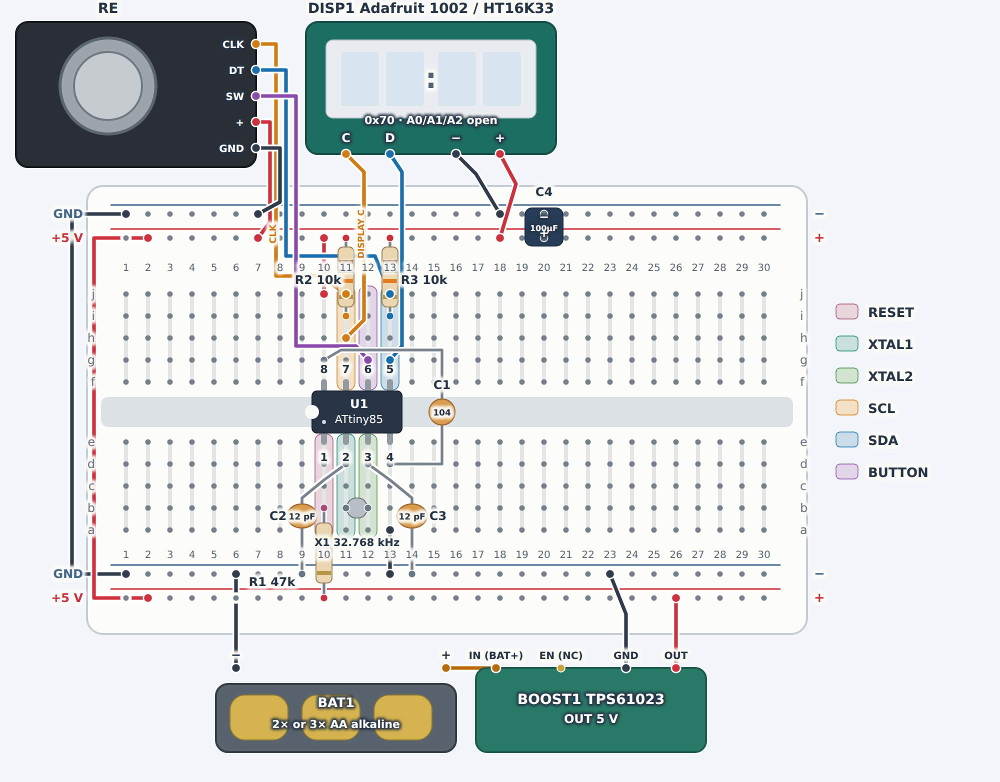

# ATtiny85 four-digit clock with rotary encoder for time setting

## Usage Logic

The time shown will be 24-hour format `hh:mm`.
The firmware has two modes that I will now name `SHOW_CLOCK` and `EDIT_TIME`.
The four possible user actions I will name `LONG_PRESS`, `SHORT_PRESS`, `CR` (clockwise-rotation) and `CCR` (creedence clearwater rotation)
If in `SHOW_CLOCK`, then the only action the user can do it `LONG_PRESS` which will change mode to `EDIT_TIME`. Doing `LONG_PRESS` again exits `EDIT_TIME`, which means the active mode will be `SHOW_CLOCK` again. In `EDIT_TIME` the user can select the next digit (left-to-right) by `SHORT_PRESS` and change the value of the current digit via `CR` (increase by 1) and `CCR` (decrease by 1). The firmware ensure that it is impossible to set an invalid time, so the first digit can only be in [0,2], the second digit can only be [0,3] when the first digit is `2`, otherwise it can be in [0,9]. The third digit can be in [0,5] and the fourth digit can be in [0,9]. I can see why a user might be confused when trying to set the first digit from `1` to `2` and it does not work because the second digit is currently `4` or larger, but it is a small price to pay for ensuring always-have-valid-time. In such a scenario the user then would have to first change the second digit and then the first digit. Anyway, you don't have to set the clock often because it stays in sync and the batteries are expected to last multiple weeks (depends on whether you use 2x or 3x AA).

## Parts

| Quantity | Part |
| ---: | --- |
| 1 | ATtiny85 |
| 1 | Adafruit 1002 white 0.56-inch four-digit white display with HT16K33 backpack |
| 1 | Adafruit MiniBoost 5 V, product 4654 |
| 1 | 32.768 kHz crystal (I use ECS-.327-12.5-8X-C) |
| 1 | Joy-IT COM-KY040RE rotary encoder module (also acts as push button) |
| 1| 100 µF electrolytic cap |
| 1 | 100 nF ceramic cap |
| 2 | 12 pF ceramic caps |
| 1 | 47 kΩ resistor for RESET |
| 2 | 10 kΩ I2C pull-up resistors |
| 1 | 2x or 3xAA holder |

### ATtiny85 pinout

| ATtiny85 pin | Function |
| ---: | --- |
| 1 | `RESET` |
| 2 | `PB3/XTAL1` |
| 3 | `PB4/XTAL2` |
| 4 | `GND` |
| 5 | `PB0/SDA` |
| 6 | `PB1/MISO` |
| 7 | `PB2/SCL` |
| 8 | `VCC` |

### Rotary encoder pinout

The ATtiny85 has only one otherwise-free GPIO after assigning two crystal pins
and two I2C pins. The encoder therefore shares its two open-contact rotation
signals with the normally idle open-drain I2C bus:

| Encoder pin | Connection |
| --- | --- |
| `CLK` | ATtiny pin 7 / PB2 / display SCL |
| `DT` | ATtiny pin 5 / PB0 / display SDA |
| `SW` | ATtiny pin 6 / PB1 |
| `+` | V+ |
| `GND` | GND |

This works because the encoder contacts and I2C devices only pull the shared
signals low. The firmware samples the encoder only outside I2C transactions and
waits for both rotation contacts to return high and remain quiet before updating
the display. A rotation during a display transaction can sometimes be missed, but cannot
electrically short an actively driven high output because SDA and SCL are always
implemented as open-drain signals.

### LED and its header

Important: When you look at the LED and the dots are at the bottom of the screen, then the header above should show the I2C pins from left-to-right as `+`, `-`, `SDA`, `SCL`. If it is the other way around, it means you have put the header on the wrong side which is an easy mistake to make because even then the text at its bottom (and the four pins at the top) are readable. I basically had wasted lots of time because I soldered it the wrong way and only was able to show '7' for the second digit and the small dot right next to it, no other digits worked until I fixed my mistake.

## Programming the Attiny85

Since we use an external clock it is a bit more complicated than usual, and whatever (DIY) programmer you use must also have an external clock setup that can be used (e.g. I use the Arduino Nano Every as flasher and built a simple circuit that allows me to use an external 32 kHz clock if needed). Just make sure to run ArduinoISP at a 4 kHz SPI clock, connect a 32.768 kHz crystal (and the two 12 pF caps) to your programmer, and compile the firmware for a 32.768 Hz ATtiny85. Flash the firmware, then set the low fuse to `0xE6` and verify that the fuses read `E6/DF/FF`.

## Result

Building this project was a bit of a pain because initially everything went wrong: First I ran out of red wire, then I accidentally soldered the display header with the wrong orientation and had to pull out my Logic Analyzer to debug it (that proved the I2C communication worked fine, which meant it must be shorted pins on the LED or a header that was soldered the wrong way xD), then desoldering everything was pain even with low-melt solder + good wick + adafruit engineer sucker, then I had to expand with DIY flasher with an external clock so that it still can communicate with the attiny after it had its fuse set to use an external clock, then I broke off an attiny leg from removing it from its socket too often for firmware tests and had to find another one, then I had to test-fix-repeat until the firmware played along well with the rotary encoder inputs. All in all way more complicated than the 'just put the 4 digit clock project in the bag lil bro' idea seemed initially. 

Anyway, the clock works well now and the set-time functionality is very intuitive. The clock stays in sync with the more professional clocks I own and the display looks great. Most importantly: I learned a lot in the process.