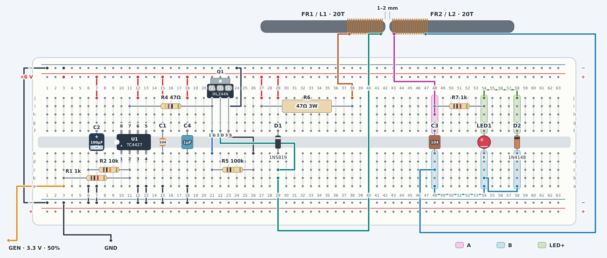

# Four-AA wireless LED circuit

## Screenshots



## Overview

Demo that showcases how to power an LED 'wirelessly' via electromagnetic induction through magnetic coupling between two
coils. Since we transfer power to the LED via inductive coupling, we basically have sth like a transformer whose windings sit on separate ferrite rods, with an air gap between them. We use an external function generator to turn the MOSFET ON. Apart from the LED, if you observe the
coil current limiter resistor temperatur with a thermal cam you can slowly see its temp rise while the function generator is on,
and slowly drop back to room temp when the function generator is off.

## Complete parts list

| Ref | Qty | Part / value | Use |
| --- | ---: | --- | --- |
| U1 | 1 | **TC4427CPA, DIP-8** | Non-inverting gate driver |
| Q1 | 1 | **IRLZ44N, TO-220** | Coil switch |
| R5 | 1 | 100 kΩ, ¼ W | Gate-to-source pull-down |
| R2 | 1 | 10 kΩ, ¼ W | U1 input pull-down |
| R1 | 1 | 1 kΩ, ¼ W | Generator series resistor |
| R7 | 1 | 1 kΩ, ¼ W | Receiver current limiter |
| R4 | 1 | 47 Ω, ¼ W | MOSFET gate resistor |
| R6 | 1 | **47 Ω, 3 W** (owned); alternatives: 68 Ω, ≥2 W, or four 270 Ω, ¼ W in parallel | Coil-current limiter |
| D1 | 1 | 1N5819, axial | Transmitter flyback clamp |
| D2 | 1 | 1N4148, axial | LED reverse-voltage protection |
| LED1 | 1 | Red through-hole LED | Wireless power indication |
| C3 | 1 | Owned **HQX 0.1 µF / 250 V film** | Receiver tuning, nonpolarized |
| C2 | 1 | 100 µF electrolytic, ≥16 V | Transmitter bulk decoupling |
| C1 | 1 | 100 nF ceramic, ≥16 V | U1 local bypass |
| C4 | 1 | 1 µF pp film, ≥16 V | U1 local bypass |
| FR1, FR2 | 2 | **Fair-Rite 4078377511**, material 78, **9.5 mm diameter × 70 mm long** | Matching separate ferrite rods |
| L1 | 1 | **20 turns**, 0.4 mm enamelled wire, on FR1 | Starting transmitter coil; measure inductance |
| L2 | 1 | **20 turns**, 0.4 mm enamelled wire, on FR2 | Starting receiver coil; measure inductance |
| — | 4 | AA alkaline cells in series | Power source |


## Pinouts


### U1 TC4427CPA

```text
             notch
         +----U----+
    NC 1 |         | 8 NC
  IN A 2 | TC4427  | 7 OUT A
   GND 3 |         | 6 VDD
  IN B 4 |         | 5 OUT B
         +---------+
```

| Pin | Function | Solder connection |
| ---: | --- | --- |
| 1 | NC | Leave unconnected |
| 2 | IN A | R1 from generator; R2 to GND |
| 3 | GND | Battery negative, generator black clip, Q1 source |
| 4 | IN B, unused channel | Tie to GND |
| 5 | OUT B, unused output | Leave unconnected |
| 6 | VDD | Battery positive; C1, C4 and C2 to GND |
| 7 | OUT A | Through R4 to Q1 gate |
| 8 | NC | Leave unconnected |

### Q1 IRLZ44N

Printed front facing you, legs pointing down:

* Pin 1 left = gate
* Pin 2 centre = drain (the metal tab is also drain)
* Pin 3 right = source

## Hand-wiring the two coils

I am using two **4078377511 material-78 ferrite rods** (for power
applications up to 200 kHz). I use around 20 turns of 0.4mm enameled copper wire,
all turns near one end of the rod. Later we position both rods so that the two coils are very close to each other.


## Transmitter Coil

1. Solder a pin to the `-` rail (function generator ground will later clip to that)
2. Solder **U1 (TC4427CPA)**.
3. Solder a wire between **U1 pin 6** and the **`+` rail**.
4. Solder a wire between **U1 pin 3** and the **`-` rail**.
5. Solder a wire between **U1 pin 4** and the **`-` rail**.
6. Solder **R2 (10 kΩ)** between **U1 pin 2** and the **`-` rail**.
(7. Leave **U1 pins 1, 5 and 8 unconnected**.)
8. Solder **C1 (100 nF ceramic)** between **U1 pins 6 and 3**.
9. Solder **C4 (1 µF pp film cap)** between **U1 pins 6 and 3**.
10. Solder **C2 (100 µF electrolytic)** between `+` and `-` rail near U1.

---

11. Solder **Q1 (IRLZ44N)**.
12. Solder a wire between **Q1 pin 3 (source)** and the **`-` rail**.
13. Solder **R4 (47 Ω, ¼ W)** between **U1 pin 7** and **Q1 pin 1 (gate)**.
14. Solder **R5 (100 kΩ)** between **Q1 pin 1 (gate)** and **Q1 pin 3 (source)**.
15. Solder one end of **R1 (1 kΩ)** to **U1 pin 2**. Solder its other end to
    a separate row labelled **`GEN`**.
16. Solder a pin to the **`GEN`** row (the function generator `+` lead will clip to that later).

---

17. Solder one end of **R6 (47 Ω, 3 W)** to the **`+` rail**. Solder its other
    end to a separate row labelled **`TX_FEED`**. Leave space around its body
    for cooling (this resistor will get hot).
18. Solder **one end of coil L1** to **`TX_FEED`**.
19. Solder **the other end of L1** to **Q1 pin 2 (drain)**.
20. Solder **D1 (1N5819)** between **Q1 pin 2** and the **`+` rail**:
    **unbanded end to Q1 pin 2**, **banded (silver) end to the `+` rail**.

## Receiver wiring (step by step)

21. Position the two rods **end-to-end, with a 1–2 mm gap**, as shown above.
22. Solder **one end of L2** to a row labelled **`A`**.
23. Solder **the other end of L2** to a row labelled **`B`**.
24. Solder **C3 (100 nF unpolarized film cap)** between **`A` and `B`**.
25. Solder one end of **R7 (1 kΩ)** to **`A`** and its other end to a separate
   row labelled **`LED+`**.
26. Solder the **LED anode** to **`LED+`**.
27. Solder the **LED cathode** to **`B`**.
28. Solder **D2 (1N4148)** between **`LED+` and `B`**:
   **banded (black) end to `LED+`**, **unbanded end to `B`**.

### Tuning

Calculate the starting frequency from **L2 measured with the rods in position**:
`f = 1 / (2*pi*sqrt(L2*C3))`.

| Measured L2 | Starting frequency with 100 nF |
| ---: | ---: |
| 10 µH | 159 kHz |
| 20 µH | 113 kHz |
| 40 µH | 79.6 kHz |
| 80 µH | 56.3 kHz |
| 160 µH | 39.8 kHz |

Set a **50% duty**, **3.3 V square wave** with a frequency somewhere in **40–160 kHz* on your function generator.
Try to be in a dark room (LED might not be very bright) and sweep the frequency gently around that value to find the brightest response.

## Result

### Frequency (Duty Cycle at 50 %, Amplitude at 3.3V)
* 1 kHz: In a dark room, you can just barely see that the LED turns on
* As you increase the kHz the LED keeps getting brighter
* 180-200 kHz: LED at maximum brighness
* 300 kHZ: Slightly less bright than before
* 500 kHz: I can barely see that the LED is on
* 600 kHZ: The LED seems to be off at all times, however: the moment I turn the function generator on or off it briefly lights up slightly (mysterious transient)

* Note: Very interesting here: The ferrite core datasheet actually specifies that it is recommended to be used for applications up to 200 kHz, so it
is amazing that I could independently observe this.

### Duty Cycle (Frequency at 200 kHz, Duty Cycle at 3.3V)
* 1% - 4%: Brightness rises sharply
* 10% - 50%: Maximum brightness, no noticable difference in this interval
* 70% - 80%: The brightness sharply drops, at 80% the LED is barely on. This part suprised me tbh, I did not expect a dropoff at all and I do not have the equipment to precise figure out why this happens

### Amplitude

* 0 to 1.6 V: LED seems to be off
* 1.7V to 1.8V: LED brightness rises sharply
* 1.8V to 3.3V: Brightness stays at the same maximum brightness

* If you look at the TC4427 datasheet it says that that HIGH recognition is guaranteed at 2.4V or above, so it is intersting that here it works as low as 1.7V

---

* All in all, it was very interesting to see how the different function generator parameters affected the LED brighess.
For maximum brightness in my specific setup I used 200 kHz, 50% duty, 3.3V amplitude square wave.
The 1-2mm air gap between the two coils is arguably the most important part of this build: Just slightly move one coil (or starring at it in the wrong way)
and the LED won't turn on at all anymore, I had to do a few microadjustments to get this positioning right.