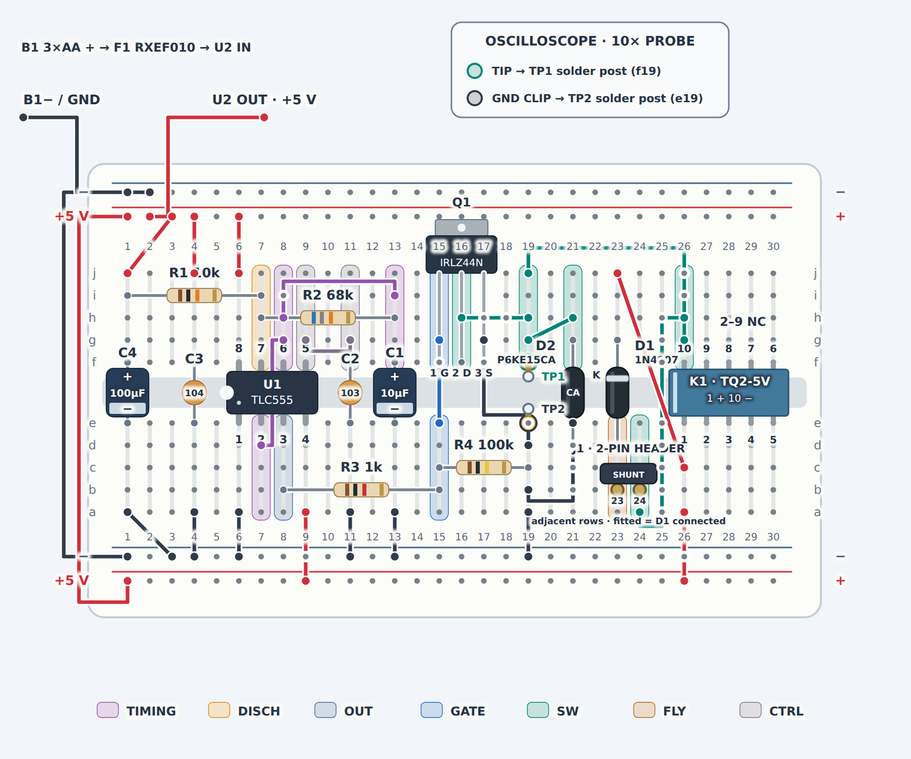

# Relay flyback spike demo




A 555 timer switches a relay repeatedly, roughly 0.54 s on / 0.47 s off. The user can add or remove a jumper:

* **J1 Bridge added:** flyback diode connected, this is the **correct** way to safely use relays with TVS-limited flyback.
* **J1 Bridge removed:** flyback diode disconnected, educational **bad but still safe** example to clearly show the voltage spikes that you should avoid.

## Parts

| Ref. | Part / value | Qty. |
|---|---|---:|
| U1 | TLC555IP, DIP-8 | 1 |
| K1 | Panasonic TQ2-5V | 1 |
| Q1 | IRLZ44N | 1 |
| D1 | 1N4007 flyback diode | 1 |
| D2 | Littelfuse P6KE15CA, bidirectional TVS | 1 |
| J1 | 2-pin 2.54 mm header plus removable jumper shunt | 1 |
| U2 | Adafruit 3661 Miniboost, AP3602A 5 V / 100 mA charge-pump board | 1 |
| B1 | 2x or 3x battery holder and two/three matched AA alkaline cells (doesn't matter) | 1 |
| R1 | 10 kΩ, ¼ W | 1 |
| R2 | 68 kΩ, ¼ W | 1 |
| R3 | 1 kΩ, ¼ W | 1 |
| R4 | 100 kΩ, ¼ W | 1 |
| C1 | 10 µF electrolytic, ≥10 V | 1 |
| C2 | 10 nF ceramic | 1 |
| C3 | 100 nF ceramic | 1 |
| C4 | 100 µF electrolytic, ≥10 V | 1 |
| TP1, TP2 | Two soldered bare-wire posts/loops for probe tip and ground | 2 |

Note: U2 converts the roughly 3-5 V battery input to 5 V. The relay coil draws approximately 28 mA
while energised and the complete circuit remains well below U2's 100 mA rating.

## Pinouts

**U1, viewed from above, notch upwards:**

```text
           notch
       ┌────∪────┐
  GND 1│         │8 VDD
 TRIG 2│ TLC555IP│7 DISCH
  OUT 3│         │6 THRES
RESET 4│         │5 CONT
       └─────────┘
```

| Pin | Function / connection |
|---|---|
| 1 GND | Ground rail |
| 2 TRIG | Starts the on interval |
| 3 OUT | Relay drive signal, |
| 4 RESET | Active-low reset |
| 5 CONT | Threshold reference |
| 6 THRES | Ends the on interval |
| 7 DISCH | Timing-capacitor discharge |
| 8 VDD | +5 V |

---

**Q1:** hold the printed face towards you, legs down. Left to right:
**1 gate, 2 drain, 3 source**. The metal tab is also **drain**.

---

**K1:** bottom view, looking directly at the legs. Put the marked coil end on
the left.

```text
 coil end       unused contacts
  1 (+)    2     3     4     5
 10 (−)    9     8     7     6
```

Pin **1 is coil +5 V**, pin **10 is switched coil negative**. Pins 2-9 remain
unconnected.

---

**D1:** stripe = cathode, towards +5 V. **D2:** the **CA** version I use is
bidirectional, so either orientation works.

---

**U2, using its printed pad labels:** `IN` = battery input after F1, `GND` =
battery negative/circuit ground, `OUT` = regulated 5 V rail, and `EN` =
enable. Leave `EN` unconnected.

---

**Adafruit 3661** pins:

* `In` is the battery input (anything in 3V to 5V is allowed)
* `G` is Ground (battery `-` and also wired to breadboard `-` rail)
* `5Vo` is the regulated 5v output this breakout provides
* `En` is the cable control (just leave it disconnected, if u wire it to `G` you disable the converter)

So this breakout is perfect for 3x alkaline, or 3x nimh or a suited 1x lithium battery.

## Oscilloscope connection and settings

Use a 10× passive probe, connect the Probe ground clip to TP2 GND, connect the other probe tip to TP1 SW.

For settings I used 5 V/div and 1 ms/div with a rising-edge trigger at 8V (to showcase the bad case) or 3V (for the case where we use the jumper).

---

Result:

| J1 | waveform at relay turn-off |
|---|---|
| Shunt fitted | Rises from near 0 V to about **6 V**, then settles at +5 V as coil current decays |
| Shunt removed | Rises to roughly **15-20 V**, limited by D2, then settles at +5 V, the higher-voltage pulse is shorter |

So we can nicely see the voltage spikes you should avoid by adding a flyback diode.